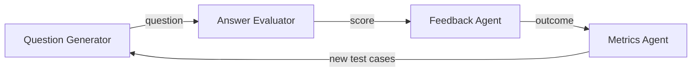

# interview-prep-agents

An open-source **multi-agent pipeline for interview practice**, built by the Leopard Community.

Four small agents each do one job and pass their results along:



| Agent | Job | Lives in |
|---|---|---|
| Question Generator | Creates interview questions by topic and difficulty | `src/interview_prep/agents/question_generator.py` |
| Answer Evaluator | Scores a practice answer against a rubric | `src/interview_prep/agents/answer_evaluator.py` |
| Feedback Agent | Turns a score into specific, actionable feedback | `src/interview_prep/agents/feedback.py` |
| Metrics Agent | Logs outcomes and feeds new test cases back to the generator | `src/interview_prep/agents/metrics.py` |

The shared data types the agents pass to each other are in `src/interview_prep/models.py`. **Agree on changes there with the other teams first.** It's the contract that holds the pipeline together.

> **Status:** early scaffold. Every agent is a stub that returns placeholder output so the pipeline runs end to end. Teams replace the stubs with real implementations.

## Quick start

```bash
git clone https://github.com/GoNextPath/interview-prep-agents.git
cd interview-prep-agents
python -m venv .venv && source .venv/bin/activate
pip install -e ".[dev]"

ruff check . && pytest     # lint and run the tests (do this before every push)
python -m interview_prep   # run one question through the whole pipeline
```

Requires Python 3.10+. Check with `python3 --version`. macOS ships with Python 3.9, so on a Mac install a newer one with [Homebrew](https://brew.sh) (`brew install python@3.11`) and create the environment with `python3.11 -m venv .venv` instead.

`python -m interview_prep` asks you to type an answer. To run it without typing, for example in a script, pass one: `python -m interview_prep --answer "your answer"`. Other options are `--topic` and `--difficulty easy|medium|hard`.

To contribute, fork the repo and clone your fork instead. See [CONTRIBUTING.md](CONTRIBUTING.md).

> **Using Claude Code Desktop?** [`docs/local_setup_ClaudeCodeDesktop.md`](docs/local_setup_ClaudeCodeDesktop.md) shows how to do this setup, run the checks and open a PR from inside the app. The commands themselves live only here.

## Repo layout

```
src/interview_prep/
  models.py          # shared data types (the contract between agents)
  pipeline.py        # wires the four agents together
  agents/            # one module per agent
tests/               # unit tests, one file per agent plus the pipeline
evals/               # evaluation harness and datasets
notebooks/           # example notebooks
docs/                # design doc, MVP, milestones, decisions
```

## Teams

Each area has a small sub-team that stays with it for several weeks. See [`docs/teams.md`](docs/teams.md).

## Contributing

Start with [CONTRIBUTING.md](CONTRIBUTING.md). Contributing is optional and self-paced: help as much or as little as you like.

## Security

This project calls LLMs and is public, so prompt injection, untrusted model output, secrets and dependencies all need care. See [SECURITY.md](SECURITY.md).

## License

[MIT](LICENSE)
