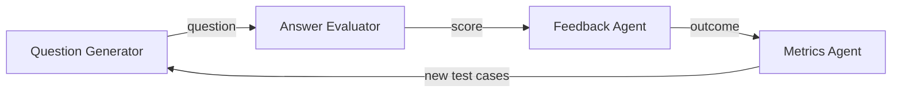

# interview-prep-agents

An open-source **multi-agent pipeline for interview practice**, built by the Leopard Community.

Four small agents each do one job and pass their results along:



| Agent | Job | Lives in |
| --- | --- | --- |
| Question Generator | Creates interview questions by topic and difficulty | `src/interview_prep/agents/question_generator.py` |
| Answer Evaluator | Scores a practice answer against a rubric | `src/interview_prep/agents/answer_evaluator.py` |
| Feedback Agent | Turns a score into specific, actionable feedback | `src/interview_prep/agents/feedback.py` |
| Metrics Agent | Logs outcomes and feeds new test cases back to the generator | `src/interview_prep/agents/metrics.py` |

The shared data types the agents pass to each other are in `src/interview_prep/models.py`. **Agree on changes there with the other teams first.** It's the contract that holds the pipeline together.

> **Status:** early scaffold. Every agent is a stub that returns placeholder output so the pipeline runs end to end. Teams replace the stubs with real implementations.

## Prerequisites

- **Git**
- **[uv](https://docs.astral.sh/uv/)**, which manages Python, the virtual environment and dependencies. Install it once:

  | Platform | Command |
  | --- | --- |
  | macOS / Linux | `curl -LsSf https://astral.sh/uv/install.sh \| sh` (or `brew install uv`) |
  | Windows | `powershell -ExecutionPolicy ByPass -c "irm https://astral.sh/uv/install.ps1 \| iex"` (or `winget install --id=astral-sh.uv -e`) |
  | Any, with Python already installed | `pipx install uv` |

  Check it worked with `uv --version`. See the [uv installation guide](https://docs.astral.sh/uv/getting-started/installation/) for other options.

You don't need to install Python separately: if `uv sync` can't find Python 3.10 or newer, it downloads one. You only need your own Python 3.10+ if you use the [pip workflow](#pip-workflow) below.

## Quick start

```bash
git clone https://github.com/GoNextPath/interview-prep-agents.git
cd interview-prep-agents
uv sync --extra dev               # create .venv and install from uv.lock

uv run pytest                     # run the tests
uv run python -m interview_prep   # run one question through the whole pipeline
```

### pip workflow

Steps if you prefer to use pip.  Note: pip doesn't read uv.lock, so the versions on your local may be different than what is used in CI.

```bash
python -m venv .venv && source .venv/bin/activate
pip install -e ".[dev]"
pytest
```

## Repo layout

```bash
src/interview_prep/
  models.py          # shared data types (the contract between agents)
  pipeline.py        # wires the four agents together
  agents/            # one module per agent
tests/               # unit tests, one file per agent plus the pipeline
evals/               # evaluation harness and datasets
notebooks/           # example notebooks
docs/                # design doc, MVP, milestones, decisions
```

## Teams

Each area has a small sub-team that stays with it for several weeks. See [`docs/teams.md`](docs/teams.md).

## Contributing

Start with [CONTRIBUTING.md](CONTRIBUTING.md). Contributing is optional and self-paced: help as much or as little as you like.

## Security

This project calls LLMs and is public, so prompt injection, untrusted model output, secrets and dependencies all need care. See [SECURITY.md](SECURITY.md).

## License

[MIT](LICENSE)
