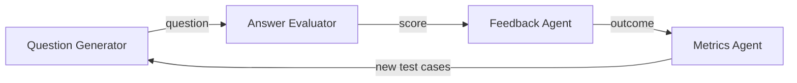

# interview-prep-agents

An open-source **multi-agent pipeline for interview practice**, built by the Leopard Community.

> **A note for visitors:** this is a study-group project rather than an open community one. The repo is public so members can point to their own work, but we aren't taking contributions from outside the group right now. Thanks for understanding, and for the interest.

Four small agents each do one job and pass their results along:



| Agent | Job | Lives in |
| --- | --- | --- |
| Question Generator | Creates interview questions by topic and difficulty | `src/interview_prep/agents/question_generator.py` |
| Answer Evaluator | Scores a practice answer against a rubric | `src/interview_prep/agents/answer_evaluator.py` |
| Feedback Agent | Turns a score into specific, actionable feedback | `src/interview_prep/agents/feedback.py` |
| Metrics Agent | Logs outcomes and feeds new test cases back to the generator | `src/interview_prep/agents/metrics.py` |

The shared data types the agents pass to each other are in `src/interview_prep/models.py`. **Agree on changes there with the other teams first.** It's the contract that holds the pipeline together.

> **Status:** early scaffold. Every agent is a stub that returns placeholder output so the pipeline runs end to end. Teams replace the stubs with real implementations.

## Prerequisites

- **Git**
- **[uv](https://docs.astral.sh/uv/)**, which manages Python, the virtual environment and dependencies. Install it once:

  | Platform | Command |
  | --- | --- |
  | macOS / Linux | `curl -LsSf https://astral.sh/uv/install.sh \| sh` (or `brew install uv`) |
  | Windows | `powershell -ExecutionPolicy ByPass -c "irm https://astral.sh/uv/install.ps1 \| iex"` (or `winget install --id=astral-sh.uv -e`) |
  | Any, with Python already installed | `pipx install uv` |

  Check it worked with `uv --version`. See the [uv installation guide](https://docs.astral.sh/uv/getting-started/installation/) for other options.

You don't need to install Python separately: if `uv sync` can't find Python 3.10 or newer, it downloads one. You only need your own Python 3.10+ if you use the [pip workflow](#pip-workflow) below.

## Quick start

```bash
git clone https://github.com/GoNextPath/interview-prep-agents.git
cd interview-prep-agents
make install                     # create .venv and install from uv.lock
make check                       # run Ruff and pytest
make run                         # run one question through the whole pipeline
make smoke                       # non-interactive CLI example
```

No API key, `.env` file, provider account, or external service is needed for the
current scaffold. All four agents use local stubs, and outcomes are stored in
memory for the lifetime of the pipeline instance.

`make smoke` runs question generation, answer evaluation, feedback, and outcome
recording with a synthetic URL-shortener design answer framed as situation,
action, and result. Expect a stub question and a score of 100% from keyword
matching; the score does not assess design quality. To also verify the
metrics-to-generator feedback loop, run
`make test TEST_ARGS="tests/test_pipeline.py -q"`. The CLI runs one round; it does
not invoke that feedback step or persist results between runs.

These commands require Make (on Windows, use WSL or a compatible Make installation).
Without Make, use `uv sync --locked --extra dev`, `uv run --locked ruff check .`,
`uv run --locked pytest`, and `uv run --locked python -m interview_prep`.

Run `make help` for all targets. Select tests with
`make test TEST_ARGS="tests/test_pipeline.py -q"`, format `src` and `tests` with
`make format` (or specific files with `make format FILES="path/to/file.py"`), and pass CLI options with
`make run ARGS="--topic teamwork --difficulty medium"`.

> **Using Claude Code Desktop?** [`docs/local_setup_ClaudeCodeDesktop.md`](docs/local_setup_ClaudeCodeDesktop.md) shows how to do this setup, run the checks and open a PR from inside the app. The commands themselves live only here.

### pip workflow

Pip requires Python 3.10+ and does not read `uv.lock`, so installed versions may
differ from CI. On macOS/Linux or WSL, the same Make targets support pip:

```bash
make install TOOL=pip             # create .venv and install with pip
make check TOOL=pip
make run TOOL=pip
```

No activation is needed. Override `PYTHON=python3.10` during installation to choose
an interpreter, or `VENV=path/to/venv` on every command to use a different environment.

Without Make, create and activate an environment, then run the tools directly:

This needs your own Python 3.10 or newer. Check with `python3 --version`. macOS ships with Python 3.9, so on a Mac install a newer one with [Homebrew](https://brew.sh) (`brew install python@3.11`) and create the environment with `python3.11 -m venv .venv` instead.

```bash
python -m venv .venv
source .venv/bin/activate         # Windows PowerShell: .venv\Scripts\Activate.ps1
python -m pip install -e ".[dev]"
python -m ruff check .
python -m pytest
python -m interview_prep
```

## Repo layout

```bash
src/interview_prep/
  models.py          # shared data types (the contract between agents)
  pipeline.py        # wires the four agents together
  agents/            # one module per agent
tests/               # unit tests, one file per agent plus the pipeline
evals/               # evaluation harness and datasets
notebooks/           # example notebooks
docs/                # design doc, MVP, milestones, decisions
```

## Teams

Each area has a small sub-team that stays with it for several weeks. See [`docs/teams.md`](docs/teams.md).

## Contributing

Start with [CONTRIBUTING.md](CONTRIBUTING.md). Contributing is optional and self-paced: help as much or as little as you like.

## Security

This project calls LLMs and is public, so prompt injection, untrusted model output, secrets and dependencies all need care. See [SECURITY.md](SECURITY.md).

## License

[MIT](LICENSE)
