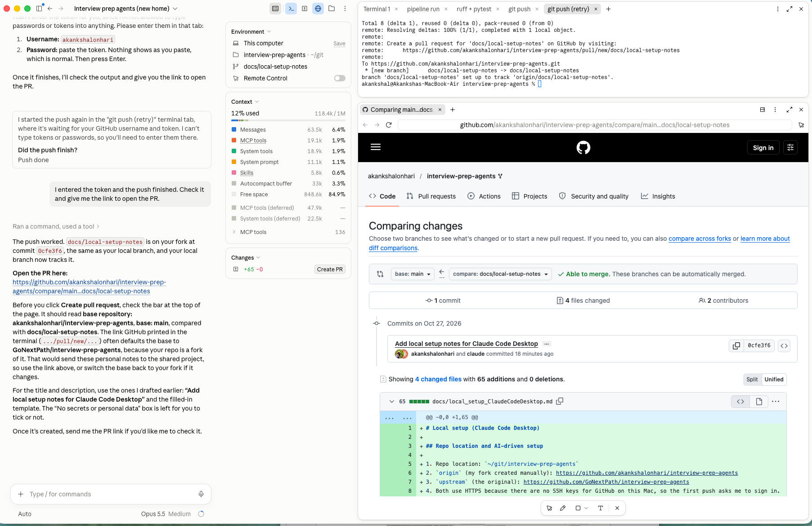

# Local setup (Claude Code Desktop)

This doc covers only what's specific to Claude Code Desktop. The setup and run commands live in the [README's Quick start](../README.md#quick-start), and the fork, branch and push steps live in [CONTRIBUTING.md](../CONTRIBUTING.md). Update those files, not this one, when the commands change.

## Starting a session

1. Fork the repo and clone your fork as described in [CONTRIBUTING.md](../CONTRIBUTING.md#getting-set-up).
2. In Claude Code Desktop, start a session with the clone as its folder. Prompt used: "I want to use Claude Code on my project, start a new session with ~/git/interview-prep-agents as the folder."

   

3. Ask Claude to set up the project. It follows the README's Quick start: it creates `.venv`, installs the dev dependencies and runs the tests. If your `python3` is older than 3.10, it uses a newer Python instead.

## Browsing the code

1. Use the **Files pane** beside the chat: click a file link in Claude's messages, browse the file tree, or ask Claude to open a file (for example "open models.py").

   

## Running checks in the Terminal pane

1. Ask Claude to run the checks, for example "run and display the pytest and ruff checks". It runs them in a tab in the **Terminal pane** so you can watch the output.
2. The tabs stay open with `.venv` active, so you can type more commands there yourself.

   

## Creating a PR

1. Click **Create PR**. Claude creates a branch (for example `docs/local-setup-notes`), commits the changes and pushes the branch to your fork.
2. The first push asks you to sign in to GitHub in a Terminal pane tab. Claude can't type tokens, so enter your username and token there yourself. CONTRIBUTING.md explains [which token to create](../CONTRIBUTING.md#how-we-work). After one successful push, macOS keeps the token in the keychain, so later pushes don't ask.
3. If the GitHub CLI (`gh`) isn't installed, Claude can't open the PR itself. Open `https://github.com/<your-username>/interview-prep-agents/compare/main...<branch>` instead.
   - Check which base repository the PR targets: your fork, or `GoNextPath` for a PR to the shared project.
   - Fill in the PR template, then click **Create pull request**. The PR is then ready for review, not a draft.

   
